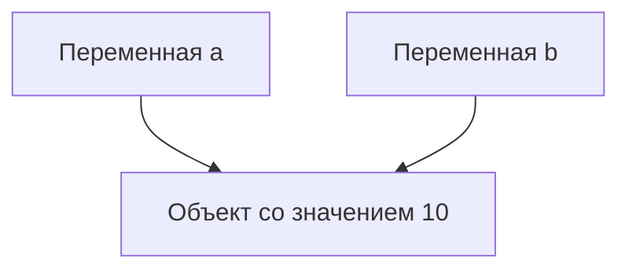
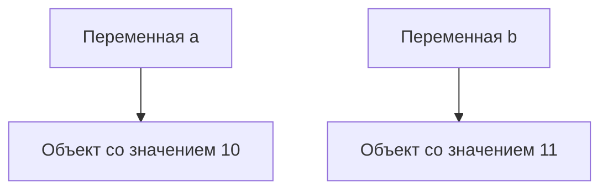
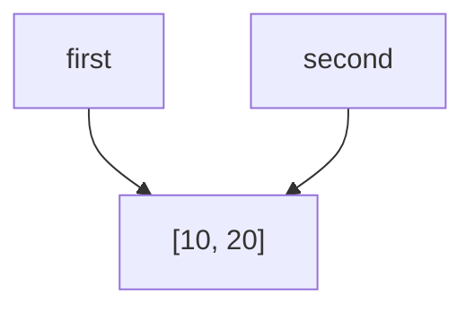
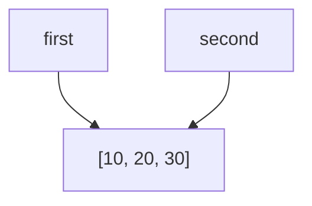

# Лабораторная 1
## Задание 1
Дан код:
```py
a = 10
b = a

print(a, b)
print(id(a), id(b))

a += 1

print(a, b)
print(id(a), id(b))
```

Результат кода:
```py
10 10
4340245560 4340245560
11 10
4340245592 4340245560
```

После изменения значения переменной a на 1, она стала указывать на другой объект, хотя по логике значение объекта должно было измениться. Это происходит из-за кэширования малых чисел. В памяти питона есть ссылки на целые числа от -5 до 256. Если переменная равна одному из этих чисел, то будет указывать на заранее созданный объект с таким числом. Поэтому переменная a, равная 11 после преобразования, указывает на объект, который принадлежит числу 11.

### Схема связей эксперимента A до


### Схема связей эксперимента A после


### Схема связей эксперимента B до


### Схема связей эксперимента B после


### Контрольные вопросы
1. Меняет ли `second = first` сам объект?

Ответ: Нет. Присваивание в Python не копирует объект и не изменяет его. Оно только связывает имя second с тем же объектом, на который уже ссылается first.

2. Почему операция над неизменяемым объектом приводит к связыванию имени с другим объектом?

Ответ: Потому что неизменяемый объект (int, str и т.п.) нельзя изменить на месте. Любая операция, которая выглядит как изменение, на самом деле создаёт новый объект, а имя затем привязывается к этому новому объекту.

3. Как определить, что два имени обозначают один объект?

Ответ: Использовать оператор `is` или сравнить `id()`

## Задание 2
### Таблица изменений

| Операция            | Новый внешний объект | Новые вложенные объекты | Изменения независимы |
| ------------------- | -------------------- | ----------------------- | -------------------- |
| Присваивание        | Нет                  | Нет                     | Нет                  |
| Поверхностная копия | Да                   | Нет                     | Частично             |
| Глубокая копия      | Да                   | Да                      | Да                   |

### Разница создания матриц

Создание матрицы через операцию *, просто создаст 3 ссылки на один и тот же массив. Из-за этого, если мы изменим строку в матрице, изменятся все остальные строки. Для создания правильной матрицы стоит воспользоваться циклом for.

### Вопросы для анализа
1. Чем поверхностная копия отличается от глубокой?

Ответ: Поверхностная копия копирует только верхний уровень объекта. Если внутри содержатся ссылки на другие объекты (например, список внутри словаря), то копируются только эти ссылки, а не сами вложенные данные. Изменение вложенного объекта в копии затронет оригинал (и наоборот), глубокая копия создает полностью независимую копию объекта вместе со всеми вложенными структурами рекурсивно.

2. Почему глубокое копирование не следует применять автоматически ко всем объектам?

Ответ: Глубокое копирования (в отличие от поверхостного) потребляет больше памяти, занимает больше времени. Не каждый вид данных нуждается в создании нового объекта, некоторые данные могут выдать ошибку при создании копии.

3. В каких случаях достаточно поверхностной копии?

Ответ: Поверхностной копии достаточно во всех ситуациях, когда изменение структуры скопированного объекта не должно затрагивать оригинал, но сами внутренние элементы менять не планируется (или они неизменяемы).

## Задание 3
### Исследование счетчика ссылок
Дан следующий код:
```py
import sys

data = [1, 2, 3]
print("После создания:", sys.getrefcount(data))

alias = data
print("После создания alias:", sys.getrefcount(data))

container = [data]
print("После помещения в контейнер:", sys.getrefcount(data))

del alias
print("После del alias:", sys.getrefcount(data))

container.clear()
print("После очистки контейнера:", sys.getrefcount(data))
```

Ответы на вопросы:

1. Почему sys.getrefcount() показывает на одну ссылку больше

Ответ: sys.getrefcount() возвращает количество ссылок на объект плюс одну временную ссылку, которая создаётся в момент вызова самой функции. Эта временная ссылка сразу исчезает после завершения функции подсчета ссылок.

2. Какие инструкции увеличивают счётчик ссылок

Ответ: Созданик алиаса: `alias = data` и помещение в контейнер `container = [data]`

3. Какие инструкции уменьшают счётчик ссылок

Ответ: Удаление алиаса `del alias`, очищение контейнера `container.clear()`

4. Почему del alias удаляет имя, а не командует напрямую удалить объект

Ответ: Это одно из отличий Python от языков вроде C++. Оператор del не является командой "уничтожить объект". Он выполняет только одно действие: удаляет привязку между именем и объектом в текущем пространстве имён.

### Слабая ссылка
Дан следующий код:
```py
import weakref


class Record:
    pass


record = Record()
weak_record = weakref.ref(record)

print(weak_record())
del record
print(weak_record())
```

Почему слабая ссылка не продлевает время жизни объекта?

Ответ: Слабая ссылка не продлевает жизнь объекта, потому что она не увеличивает его счётчик ссылок. В CPython время жизни объекта напрямую зависит от количества сильных ссылок на него. Как только это число достигает нуля, объект немедленно уничтожается, и все слабые ссылки на него становятся недействительными, начиная возвращать None.

Самостоятельно найдите пример ситуации, в которой слабые ссылки могут быть полезны.

Ответ: Например, отслеживание объектов для отладки или управления ресурсами, не влияя на их жизненный цикл. Также можно создавать словарь с кэшем, который удаляется со временем.

### Контрольные вопросы

1. При каком условии подсчет ссылок позволяет освободить объект?

Ответ: Подсчет ссылок в Python позволяет освободить объект в памяти в тот самый момент, когда счетчик **сильных** ссылок на него становится равен нулю.

2. Всегда ли освобождение Python-объекта означает немедленный возврат памяти операционной системе?

Ответ: Нет, не всегда. В большинстве случаев освобождение Python-объекта (даже если его счетчик ссылок упал до нуля) не означает немедленный возврат памяти операционной системе. Python (точнее, его стандартная реализация CPython) удерживает эту память внутри своего процесса для повторного использования.

3. Чем сильная ссылка отличается от слабой?

Ответ: В Python главное отличие сильной ссылки от слабой заключается в том, влияет ли ссылка на подсчет ссылок объекта и, как следствие, на время его жизни в памяти.

## Задание 4

### Сборщик мусора

Дан следующий код:
```py
import gc

first = []
second = []

first.append(second)
second.append(first)

print("first ссылается на second:", first[0] is second)
print("second ссылается на first:", second[0] is first)

print("\nИнформация о сборщике мусора (gc)")
print("Доступен ли gc: ", gc.isenabled())
print("Порог поколений: ", gc.get_threshold())
print("Статистика поколений:")
stats = gc.get_stats()
for i, stat in enumerate(stats):
    print(f"\tПоколение {i}: {stat}")

print(id(first), id(second))

del first
del second

print(gc.collect())
```

1. Объясните, почему одного подсчета ссылок недостаточно для удаления созданного цикла:

В коде после выполнения создаётся замкнутая структура:
- first (список) хранит ссылку на second — как элемент first[0].
- second (список) хранит ссылку на first — как элемент second[0].

После удаления имен first и second 2 ссылки исчезнут, но счётчик ссылок каждого списка не упадёт до нуля. У каждого объекта останется по одной ссылке — от «партнёра» по циклу.

2. Объясните назначение поколений сборщика мусора без привязки к конкретным значениям порогов:

Полный поиск циклов — операция дорогая: нужно обойти все объекты-контейнеры, проверить их ссылки, выделить достижимые и недостижимые. Если запускать такую проверку при каждом выделении памяти, программа будет тормозить.

Поколения — это способ не проверять всё подряд одинаково часто, используя статистическое наблюдение, известное как гипотеза о слабых поколениях (weak generational hypothesis):

Подавляющее большинство объектов умирает молодыми. Объект, проживший достаточно долго, с высокой вероятностью проживёт ещё долго.

Из этого следуют практические выводы: Молодые объекты надо проверять часто — там больше всего мусора, и проверка быстро себя окупает. Старые объекты надо проверять редко — там мало мусора, а обход дорогой.

### Структура графа в практической задаче
```mermaid
 схема:
graph TD
    A --> B
    B --> C
    C --> A
    D
```

код:
```py
A = {"name": "A", "edges": []}
    B = {"name": "B", "edges": []}
    C = {"name": "C", "edges": []}
    D = {"name": "D", "edges": []} 

    A["edges"].append(B)
    B["edges"].append(C)
    C["edges"].append(A)
```

### Вопросы для анализа

1. Как возникает циклическая ссылка?

Ответ: В Python циклическая ссылка возникает тогда, когда два или более объекта ссылаются друг на друга по кругу, либо когда объект ссылается сам на себя.

2. Почему объект с ненулевым счетчиком ссылок иногда может быть недостижим из программы?

Ответ: Объект с ненулевым счетчиком ссылок становится недостижим из программы в одном классическом случае: когда возникает циклическая зависимость. В Python управление памятью устроено на двух уровнях: счетчик ссылок и циклический сборщик мусора. Счетчик ссылок отвечает за мгновенное удаление, но перед циклическими зависимостями он бессилен.

3. Зачем сборщик мусора разделяет отслеживаемые объекты по поколениям?

Ответ: Сборщик мусора в Python (CPython) разделяет объекты на три поколения (Generation 0, 1 и 2) ради оптимизации производительности. Если бы сборщик мусора при каждом запуске проверял абсолютно все объекты в памяти на наличие циклических ссылок, программа бы постоянно и надолго «зависала» (ведь поиск циклов — ресурсоемкая операция). Разделение по поколениям решает эту проблему.

## Задание 5

Объясните, почему размер контейнера не обязательно включает полный размер всех объектов, на которые он ссылается.

Ответ: В Python встроенная функция sys.getsizeof() возвращает размер самого объекта-контейнера, а не объектов, которые внутри него находятся.
Контейнеры в Python (списки, словари, кортежи, множества) физически хранят не сами объекты, а только ссылки (указатели) на них в памяти.

### Список со 100 элементами
Наблюдения:

1. увеличивается ли размер списка после каждого append();

Ответ: Нет, размер увеличивался после 0, 4, 8 элемента и далее после каждого 8-ого элемента.

2. почему список резервирует место с запасом;

Ответ: Список в Python резервирует место в памяти с запасом (это называется овер-аллокацией или over-allocation) ради обеспечения высокой скорости добавления элементов.

3. чем длина списка отличается от объема выделенной памяти.

Ответ: Длинна списка (len) возвращает количество элементов в массиве. Объем памяти (sys.getsizeof()) возвразает количество памяти (в байтах), которое выделено под этот массив.

### Измерение через tracemalloc

Вывод о различии между материализованной последовательностью и объектом, который хранит правило получения значений:

Различие между материализованной последовательностью и генератором (объектом-правилом) заключается в выборе между памятью и временем: материализованная последовательность платит оперативной памятью за мгновенный доступ к любому элементу, в то время как объект-правило экономит память, вычисляя элементы на лету в процессе итерации.

## Итоговый анализ

3 Способа избегать использования лишней памяти.

1. Знать когда нужна глубокая копия элемента, а когда поверхостная. Глубокая копия занимает больше памяти, её надо использовать только при необходимости.

2. Использовать слабые ссылки, если мы не хотим изменять жизненый цикл объектов. Слабые ссылки не заставляют объект продолжать жить.

3. Не материализовать последовательность без необходимости. Это занимает огромное количество памяти, по сравнению с объектом-правилом, но зато доступ к элементу происходит за минимальное время, а в объекте-правиле это занимает больше времени.
